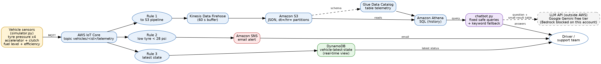

# Implementation Guide: Connected-Car Telemetry on AWS

| | |
|---|---|
| Author | Arjun M |
| Reviewer | Balaji Srinivasan |
| Date | [date] |
| Status | Draft 1.0 (see Appendix C) |

> Yellow-bracket items [like this] are for you to fill. Insert your own screenshots where marked [SCREENSHOT].
> Do not keep any statement here that you did not run or verify yourself.

## 1. Overview
This guide documents a proof of concept for a connected-car scenario (as in BMW- or Ford-style apps): vehicle sensors send data
to AWS, the data lands in queryable tables, the support team is alerted about problems, and a chatbot answers questions about the fleet.
The sensors are **simulated by a Python script** (no physical hardware was used). Everything on the AWS side is real and defined as
code (CloudFormation). Three sensor groups were requested: tyre pressure, accelerator and clutch, and fuel efficiency.

## 2. Scope and assumptions
- 3 simulated cars (CAR-001 to CAR-003), one message every 2 seconds each.
- Single AWS account and region (Asia Pacific Mumbai, ap-south-1).
- Not covered: real device authentication with X.509 certificates, mobile app, production monitoring, multi-region.

## 3. Architecture

*Figure 1. Architecture. Generated from architecture.dot (Graphviz); the script was written with AI assistance (see Appendix B).*

## 4. Services used
| Service | Purpose | How it is used here |
|---|---|---|
| AWS IoT Core | Receives device messages (MQTT) | Topic `vehicles/<id>/telemetry`; 3 rules |
| Amazon Data Firehose | Buffers a stream and delivers to storage | Writes JSON to S3 every 60 s |
| Amazon S3 | Storage | Partitioned by `dt=` (date) and `hr=` (hour, UTC) |
| AWS Glue Data Catalog | Table definition | Table `telemetry` with partition projection (no crawler needed) |
| Amazon Athena | SQL on S3 | History and reports; workgroup `vehicle-telemetry` |
| Amazon SNS | Notifications | Email when a tyre is below 28 psi |
| Amazon DynamoDB | Key-value table | `vehicle-latest-state`: newest reading per car |
| LLM API (Google Gemini, free tier) | External LLM service (OpenAI-compatible API) | Chooses one of six fixed queries and phrases the result. Amazon Bedrock was tried first but is blocked on my account (Section 13) |
| AWS CloudFormation | Infrastructure as code | One template creates everything |
| AWS IAM | Access | Least-privilege roles for Firehose and the IoT rules |

## 5. Message format (one JSON message per car per reading)
`vehicle_id, event_time, tyre_fl_psi, tyre_fr_psi, tyre_rl_psi, tyre_rr_psi, accelerator_pct, clutch_pct, speed_kmph, fuel_level_pct, fuel_efficiency_kmpl`
IoT Core adds `ingest_ts` (epoch milliseconds) in the rule.

## 6. How it works
1. The simulator publishes one message per car every 2 s to IoT Core.
2. **Rule 1** forwards every message to Firehose. Firehose waits up to 60 s (or 1 MB), then writes a file to
   `telemetry/dt=YYYY-MM-DD/hr=HH/` in S3. The Glue table with partition projection lets Athena read it immediately.
3. **Rule 2** evaluates every message and publishes to SNS when any tyre is below 28 psi.
4. **Rule 3** writes every message to DynamoDB with `vehicle_id` as the key, so the table always holds each car's newest reading.
5. The chatbot asks an LLM to pick one of six pre-written read-only Athena queries, runs that query in AWS, and asks the LLM to phrase the small result. Without a working LLM it uses keyword routing.

**Near-real-time vs real-time.** Rule 3 (DynamoDB) updates within about a second. The S3/Athena path is near-real-time
(about 1-2 minutes) because Firehose batches records; this is normal and cost-efficient for analytics. A higher-volume
production design could add Amazon Kinesis Data Streams for stream processing (Section 15).

## 7. Setup
See `docs/RUNBOOK.md` for exact commands. Summary: deploy the CloudFormation stack, confirm the SNS email,
run `simulator.py`, query in Athena.

## 8. Results (verified in my AWS account)
- Stack deployed successfully; 3 IoT rules active (Phase 1 showed 2; the third was added later); Firehose stream active. [SCREENSHOT]
- MQTT test client showed live messages on `vehicles/+/telemetry`. [SCREENSHOT]
- S3 contained files under `telemetry/dt=.../hr=.../`. [SCREENSHOT]
- Athena returned 65 readings for each of the three cars after a 5-batch smoke test plus a 60-batch run. [SCREENSHOT]
- Reports ran for lowest tyre pressure, average fuel efficiency and clutch usage. [SCREENSHOTS]
- The harsh-acceleration query (accelerator above 85%) returned 0 rows in that run, because the simulated pedal values did not exceed 85%.
  I kept the query as it correctly reports "no events". [SCREENSHOT]
- Leak scenario: CAR-001 front-left tyre fell below 28 psi (values around 24-26 psi were observed in Athena) and alert emails arrived. [SCREENSHOT]
- DynamoDB latest-state check: [fill after Runbook Step 3] [SCREENSHOT]
- Chatbot, keyword mode: answered lowest tyre pressure (CAR-001 min 23.7 psi, 19 readings below 28), average fuel efficiency and a CAR-001 summary. [SCREENSHOT]
- Chatbot, LLM mode: [fill after Runbook Steps 3-4: model name used, and paste one real sentence answer; if it did not work say so] [SCREENSHOT]
- Tests: 39 automated tests pass (`pytest -q`); the template passes `cfn-lint`. The LLM client is tested with mocked network calls.

## 9. Alerting
Rule 2 uses the SQL `WHERE tyre_fl_psi < 28 OR ...`. Every message below the threshold sends an email, so a long leak sends many emails.
Production would de-duplicate (for example one alert per car per hour).

## 10. Chatbot design and safety
The LLM **never writes SQL**. It only chooses one of six fixed, read-only queries (and a validated vehicle id such as CAR-001);
all queries filter on the date partition (cheap, fast). The LLM is reached through a small client for OpenAI-compatible APIs, so the provider can be changed with three environment variables (no code change). If the LLM fails for any reason, the bot falls back to keyword routing.
Unit tests cover routing, injection attempts (e.g. a vehicle id containing quotes is rejected) and the fallback.

## 11. Security
- S3 bucket: public access blocked, encryption enabled.
- IAM roles scoped to the specific stream, topic and table.
- No access keys in code; the simulator uses the caller's AWS credentials.
- Real devices should use per-device X.509 certificates and IoT policies (not done here).
- The LLM API key is typed into the terminal session only (never stored in a file or in GitHub). Only the question and a few rows of synthetic data are sent to the LLM service. The free tier may use prompts to improve the provider's products, so no real or company data must be used with it.

## 12. Cost
Pay-per-use services; a few minutes of simulation costs a few rupees. Tear down after review (Runbook).

## 13. Issues faced and lessons
Only issues I actually hit are listed.

| # | What happened | Cause | Fix | Lesson |
|---|---|---|---|---|
| 1 | `pip install --user` failed in CloudShell | CloudShell runs inside a Python virtual environment, which does not allow `--user` | Ran `pip install -r requirements.txt` without `--user` | Read the error: it was harmless and the fix was to drop one flag |
| 2 | Deploy command printed `bash: your: No such file or directory` | I typed the placeholder `<your email>` literally; `<` is a shell redirect | Re-ran with my real email address | Replace placeholders before running a command |
| 3 | Bedrock chatbot showed only `ValidationException` and fell back to the table | The bot hid the real error text | Changed the error message to include the AWS error text | Always log the real error, not just its type |
| 4 | Setting the model with `set BEDROCK_MODEL_ID=...` had no effect | `set` is Windows syntax; Linux needs `export` | Used `export` | Shell commands differ by operating system |
| 5 | Bedrock returned `Error 002: Access to Bedrock models is not allowed for this account` for Nova Lite, Nova Micro and Claude Haiku | The whole account is blocked from Bedrock (not a model or code problem); I do not know the reason | Kept the keyword fallback running and switched the LLM step to a free Google Gemini API through a generic OpenAI-compatible client. [Add the AWS Support case result if you opened one] | When one provider is blocked, a design with a provider-independent LLM client and a fallback still delivers |

## 14. Limitations
- Simulated sensors; no physical hardware or device certificates.
- History path is near-real-time (Firehose buffer).
- Alerts are not de-duplicated.
- Chatbot has six question types; unknown questions fall back to a status table.

## 15. Next steps
Real device or ESP32 with the AWS IoT Device SDK; Kinesis Data Streams for stream processing; QuickSight dashboard on Athena;
alert de-duplication; use Amazon Bedrock (already supported by the code) once account access is enabled, with Bedrock Guardrails; per-device certificates.

## 16. References
1. AWS, AWS IoT Core Developer Guide: rules and the Firehose, SNS and DynamoDB actions (docs.aws.amazon.com).
2. AWS, Amazon Data Firehose Developer Guide: custom prefixes for S3 (docs.aws.amazon.com).
3. AWS, Amazon Athena User Guide: partition projection (docs.aws.amazon.com).
4. AWS, Amazon DynamoDB Developer Guide (docs.aws.amazon.com).
5. Google, Gemini API documentation: OpenAI compatibility and API keys (ai.google.dev).
   AWS, Amazon Bedrock User Guide: Converse API (docs.aws.amazon.com), used for the optional Bedrock path.
6. AWS, AWS CloudFormation User Guide (docs.aws.amazon.com).
7. Kyndryl event-driven batch lakehouse implementation guide (my earlier work), for the S3/Glue/Athena patterns.
[Add every other source you really used.]

## Appendix A. Acronyms and terms
| Term | Meaning |
|---|---|
| AWS | Amazon Web Services |
| IoT | Internet of Things |
| MQTT | Message Queuing Telemetry Transport, a lightweight publish/subscribe protocol for devices |
| Rule (IoT) | A SQL-like filter that routes device messages to AWS services |
| Firehose | Managed service that buffers streaming data and delivers it to S3 and other targets |
| S3 | Simple Storage Service |
| Glue Data Catalog | Central metadata store describing tables over S3 files |
| Athena | Serverless SQL query service over S3 |
| Partition (projection) | Folder-based split of data (dt, hr) that Athena can prune without a crawler |
| SNS | Simple Notification Service |
| DynamoDB | Managed NoSQL key-value database |
| Bedrock | AWS service for foundation models (LLMs); blocked on my account, optional in the code |
| API / API key | Programming interface of a service / secret text that identifies the caller |
| Gemini | Google's family of LLMs; a free API key was used |
| LLM | Large language model |
| IaC / CloudFormation | Infrastructure as code / AWS's IaC service |
| IAM | Identity and Access Management |
| psi | Pounds per square inch (tyre pressure) |
| km/l | Kilometres per litre (fuel efficiency) |
| UTC / IST | Coordinated Universal Time / Indian Standard Time (UTC+5:30); S3 folders use UTC |

## Appendix B. AI usage disclosure
| Item | AI tool | What the AI did | What I did |
|---|---|---|---|
| CloudFormation template, simulator, chatbot, tests, Athena queries | Claude (Anthropic) | Generated the first versions and the architecture diagram script | Deployed on my own AWS account, ran every step, checked results, [list your changes] |
| Runbook and this guide's structure | Claude | Drafted structure and text | [Rewrote/edited sections: list], filled results from my own screenshots |
| Architecture diagram | Graphviz script written by Claude | Wrote the script | Reviewed for accuracy against the deployed system |
| Chatbot LLM | Google Gemini [model name], or "none: keyword mode" | Chooses a query and phrases the answer at run time (synthetic data only) | Tested; checked answers against the Athena tables |
No data used in this project is confidential; the sensor data is synthetic.

## Appendix C. Version history
| Version | Date | Author | Change | Reviewer feedback incorporated |
|---|---|---|---|---|
| 0.1 | [date] | Arjun M | First draft after Phase 1 deployment | n/a |
| 1.0 | [date] | Arjun M | Added DynamoDB real-time view, chatbot, tests, references, acronyms, AI disclosure | n/a |
| 1.1 | [date] | Arjun M | [Changes after Balaji's review] | [Quote each comment you addressed] |
